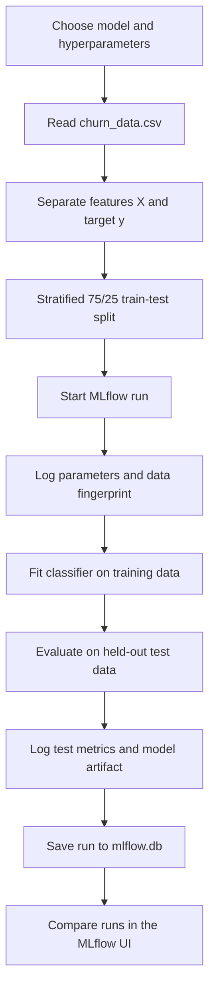

# Lab 1: MLflow Experiment Tracking

## Objective

Train customer-churn classifiers and use MLflow to track experiments. Compare
manual tracking with scikit-learn autologging so model settings, results, and
artifacts can be reviewed and compared later.

## Learning goals

- Load a dataset and separate features from the `churn` target.
- Create a reproducible, stratified training/test split.
- Train Logistic Regression, Random Forest, and Gradient Boosting models.
- Compare model configurations using held-out test metrics.
- Track parameters, metrics, tags, and model artifacts with MLflow.
- Compare manually logged information with MLflow scikit-learn autologging.

## Project files

Run the commands from `Lab1/cartvista-mlops`:

- `churn_data.csv` - dataset; `churn` is the target column.
- `train_tracked.py` - command-line model training with manual MLflow logging.
- `train_no_tracking.py` - Random Forest baseline using
  `mlflow.sklearn.autolog()`.
- `mlflow.db` - local SQLite tracking database, created when runs are logged.

## Step-by-step flow



The split uses `random_state=42` and `stratification` to make the experiment
reproducible while preserving the target-class proportions. The manually tracked
script logs test AUC, accuracy, F1, precision, and recall.

## Setup

From the Lab 1 directory:

```bash
cd cartvista-mlops
source ../../.venv/bin/activate
```

If the environment does not already have the required packages:

```bash
python -m pip install mlflow scikit-learn pandas numpy
```

Always run the scripts from `cartvista-mlops`, because they load
`churn_data.csv` and create `mlflow.db` relative to the current directory.

## Run the autologging baseline

```bash
python train_no_tracking.py
```

This script calls `mlflow.sklearn.autolog()` before fitting the Random Forest.
MLflow creates a run and records estimator parameters, metrics, and the model
artifact automatically.

## Run the manually tracked experiments

```bash
# Logistic Regression: vary regularization strength
python train_tracked.py --model logreg --C 0.1
python train_tracked.py --model logreg --C 1.0
python train_tracked.py --model logreg --C 10.0
python train_tracked.py --model logreg --C 100.0

# Random Forest: vary tree count and maximum depth
python train_tracked.py --model rf --n-estimators 50 --max-depth 4
python train_tracked.py --model rf --n-estimators 100 --max-depth 8
python train_tracked.py --model rf --n-estimators 200 --max-depth 12
python train_tracked.py --model rf --n-estimators 400 --max-depth 22

# Gradient Boosting: vary tree count and maximum depth
python train_tracked.py --model gb --n-estimators 50 --learning-rate 0.1 --max-depth 4
python train_tracked.py --model gb --n-estimators 100 --learning-rate 0.1 --max-depth 8
python train_tracked.py --model gb --n-estimators 200 --learning-rate 0.1 --max-depth 12
python train_tracked.py --model gb --n-estimators 400 --learning-rate 0.1 --max-depth 22
```

For Gradient Boosting, `--learning-rate` is a small decimal such as `0.1`;
`--n-estimators` controls the number of boosting stages. Deep trees can
overfit, so compare the held-out test metrics rather than assuming that more
estimators or greater depth is better.

## View and compare runs

Start the MLflow UI from `cartvista-mlops` in a separate terminal:

```bash
mlflow ui --backend-store-uri sqlite:///mlflow.db --port 5000
```

Open [http://127.0.0.1:5000](http://127.0.0.1:5000) and select the
`cartvista-churn` experiment. Compare parameters, metrics, and model artifacts
across the autologged baseline and manually tracked runs.

Autologging records estimator settings that the manual script does not
explicitly log, such as `criterion` and `max_features`. Manual tracking adds
project-specific information such as the data fingerprint and author tag, and
logs held-out test metrics. Autologging cannot infer those project-specific
values automatically.
